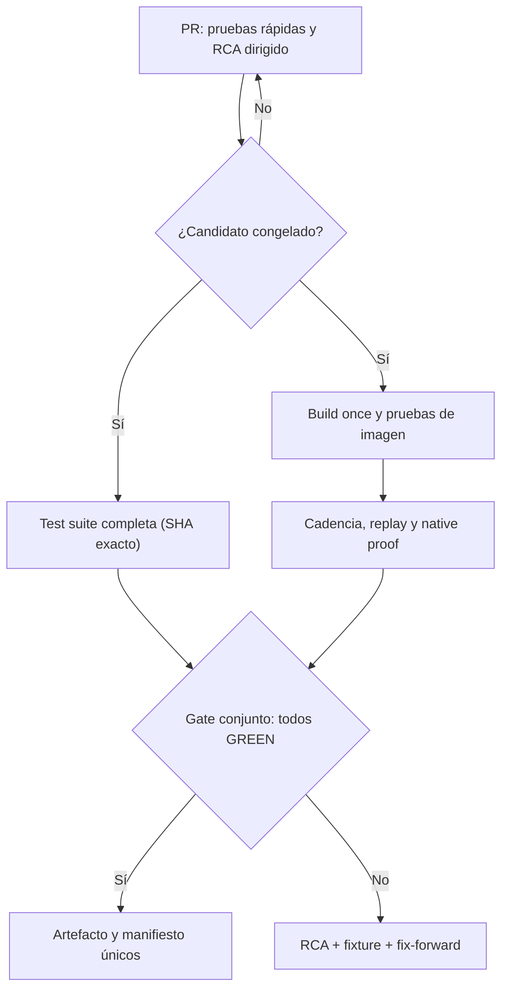

# POROTA TRADING RC6 — Auditoría READ_ONLY de velocidad de despliegue, cachés, RCA y backtesting

**Fecha del estudio:** 21 de octubre de 2026 (hora de Buenos Aires; capturas de GitHub entre el 21 y el inicio del 22 UTC).  
**Estado del trabajo:** INFORME / PROPUESTO; no se ejecutó ninguna modificación.  
**Alcance:** GitHub, GitHub Actions, definición de Deploy V2, construcción de imagen, política de tests, despliegue, operaciones de continuidad, RCA y backtesting.  
**No comprende:** ejecución de nuevos workflows, escritura de GitHub, modificación de PPI Watch, del Droplet o de la base de datos, inventario de secretos, eliminación de cachés, cambios de ownership, creación de agentes ni certificación nueva de runtime.

## 1. Dictamen ejecutivo

**La demora total no es principalmente un problema de transferencia ni de `docker build`.** El camino obligatorio de seguridad contiene pruebas físicas de cadencia y observación de runtime que son deliberadamente largas. Además, varios cambios de SHA, predeploys duplicados, cancelaciones durante pruebas costosas y defectos dependientes del estado real del host multiplican los ciclos.

Las oportunidades deben abordarse en este orden:

1. **Evitar rondas completas perdidas:** consolidación/freeze del candidato, prevención de disparos duplicados y *replay* determinista del estado de host que produjo cada RCA. Un error evitado ahorra una repetición del ciclo completo.
2. **Medir antes de optimizar:** emitir métricas por fase, cola y motivo de falla/cancelación; mantener baseline y distinguir espera física de CPU, red, build o pruebas Python.
3. **Paralelizar gates independientes fuera del host**, conservando una única certificación del SHA/tree exacto, el mismo artefacto y el gate de 0 fallas/errores/skips. Hipótesis de ahorro por ciclo: varios minutos, **no validada**.
4. **Evaluar cachés** de pip y Docker BuildKit mediante A/B controlada. Hoy `docker build` del candidato toma alrededor de 1–1,5 minutos; una caché perfecta no puede ahorrar 18 minutos de pruebas físicas.
5. **Completar el ciclo de aprendizaje de incidentes:** ERROR → RCA contrastado → FIX → GUARD → TEST ANTES/DESPUÉS → CI/PREFLIGHT → aceptación instalada, con huella de error y fixture reproducible.
6. **Hacer madurar el backtesting real** aprovechando la arquitectura ya existente de datos *point-in-time*, división temporal purgada, costos y replay. Todavía no se acreditó un proceso integral walk-forward/OOS sobre datos históricos reales.
7. **Resolver la deriva de gobierno entre `main` y productiva:** auditar los workflows heredados antes de deshabilitar alguno, impedir un deploy remoto con rebuild por un mecanismo distinto del V2 y preservar la evidencia.

**Decisión recomendada:** tratar el proyecto como un problema de **lead time + tasa de retrabajo**, no sólo de minutos de compilación. Ninguna optimización autoriza a saltear controles PAPER, identidad de artefactos, ownership ni pruebas de aceptación obligatorias.

## 2. Método, evidencia y límites

Se inspeccionaron sin mutaciones:

- Handoff de #624 fechado 20/10, sus referencias a #471/#473 y materiales de continuidad aportados por el operador (algunos cierran el 19/10: contexto histórico, no estado volátil).
- Metadatos de GitHub y ramas: a la captura, productiva `cf2c387ebea16e18702f1a6a7823ae0327744b35` y `main` `a60605160d2e59cbb94f9490d72a41c6fed8e3e8`. Ambos pueden haber avanzado desde entonces.
- YAML canónicos: [Predeploy V2](https://github.com/mbalbo2023/Porota-trading/blob/cf2c387ebea16e18702f1a6a7823ae0327744b35/.github/workflows/porota-predeploy-v2.yml) y [Deploy V2](https://github.com/mbalbo2023/Porota-trading/blob/cf2c387ebea16e18702f1a6a7823ae0327744b35/.github/workflows/porota-deploy-v2-promote.yml), [Dockerfile](https://github.com/mbalbo2023/Porota-trading/blob/cf2c387ebea16e18702f1a6a7823ae0327744b35/Dockerfile), `.dockerignore` y `ops/policy/test-policy.yaml`.
- Jobs/steps y fragmentos de logs de Actions, sin reproducir datos sensibles.
- Fuentes técnicas originales: GitHub Docs, Docker Docs, pytest, Google SRE/DORA, documentación de QuantConnect/LEAN y publicaciones de investigación financiera.

**Límites de evidencia:** no se ingresó ni se ejecutó nada en el Droplet; no se midieron cache hits de GitHub ni contenido real de su almacén de cachés; no se ejecutaron benchmarks; no se verificó operatividad actual de PPI Watch ni del bot; no se certificó walk-forward sobre dataset real. Toda ganancia futura se clasifica como *hipótesis medible*.

### 2.1 Datos de tiempo verificados

| Acción | Run | Resultado | Duración de pared |
|---|---|---|---:|
| Predeploy del SHA `122bc4eaf` | [39651245160](https://github.com/mbalbo2023/Porota-trading/actions/runs/39651245160) | SUCCESS | **27,3 min** |
| Promoción del mismo candidato, merge `f0c393ca` | [39655518694](https://github.com/mbalbo2023/Porota-trading/actions/runs/39655518694) | SUCCESS / runtime documentado por el run | **23,5 min** |
| **Suma de ejecución de ambos runs** | | | **50,8 min** |
| Predeploy `dc15f2af` | [39698103925](https://github.com/mbalbo2023/Porota-trading/actions/runs/39698103925) | SUCCESS | **27,2 min** |
| Deploy de ese candidato, merge `cf2c387e` | [39701012110](https://github.com/mbalbo2023/Porota-trading/actions/runs/39701012110) | FAILURE | **2,8 min** |
| Predeploy de SHA anterior de PR #694 | [39701836784](https://github.com/mbalbo2023/Porota-trading/actions/runs/39701836784) | CANCELLED tras otro push | **21,6 min transcurridos** |
| Predeploy de `9b138e8b` | [39692128885](https://github.com/mbalbo2023/Porota-trading/actions/runs/39692128885) | SUCCESS | **26,8 min** |
| Otro Predeploy del **mismo SHA** `9b138e8b` | [39696964377](https://github.com/mbalbo2023/Porota-trading/actions/runs/39696964377) | SUCCESS | **26,4 min** |

La suma 50,8 min omite colas, revisión, corrección de código y espera entre runs; su secuencia de reloj desde el inicio del Predeploy hasta el fin del Deploy fue aproximadamente 52 minutos. El deploy del 22/10 falló en una transición de estado del host: **no extrapolar su duración breve a una promoción exitosa**.

### 2.2 Desglose causal del Predeploy #39698103925

| Paso medido en GitHub | Segundos | Porcentaje del run (~1.632 s) | Diagnóstico |
|---|---:|---:|---|
| Prueba nativa de tamaño/catálogo/sesión/cadencia exact-image | **1.095** | **67,1 %** | Cuello de botella principal |
| Descubrimiento + instalación de dependencias + pytest raíz | **376** | **23,0 %** | Segundo foco |
| Construcción única de Docker | **93** | **5,7 %** | No explica horas |
| Checkout exacto | **27** | 1,7 % | Optimización secundaria |
| Exportación del artefacto | **16** | 1,0 % | Poco margen |
| Upload del artefacto | **11** | 0,7 % | Poco margen |
| Otros checks/overhead | ~14 | ~0,9 % | Poco margen |

La suite ejecutó **4.497 tests** sin fallas, errores ni skips, según los logs. Dentro del paso nativo hubo cinco contenedores secuenciales: casos, catálogo, sesión virtual 405, cadencia física fresca y cadencia física legacy. Los tres últimos absorben casi todo ese paso y existen por requisitos estrictos de frescura/equivalencia. No corresponde sustituirlos por un resultado cacheado de otro SHA.

El log muestra además instalación de librerías Python **dos veces** (runner y fase de construcción de Docker), de aproximadamente un minuto cada una. Esto sí justifica medir cachés, pero el techo bruto de ahorro de build sigue siendo pequeño en comparación con el gate físico.

### 2.3 ¿Qué pasa en el Droplet?

- Deploy V2 hace `docker load` de una imagen inmutable ya construida; **no hace rebuild del producto en el host**. En el run #39701012110, la transferencia del bundle consumió unos **12 s** y el paso de promoción llegó a `COLD_ARCHIVED_RECOVERY_NOT_PROVEN`; el post-load de disco estaba GREEN en esa medición.
- El Deploy exitoso #39655518694 empleó **1.269 s** en el paso compuesto de promoción y verificación. Allí hay chequeos de host, estabilización, auditoría, *soak* y diez generaciones nativas. No se debe confundir este costo de aceptación con tiempo de copiar archivos.
- El último incidente que comprobamos disparó `ValueError: COLD_ARCHIVED_RECOVERY_NOT_PROVEN` en `scripts/rc6_failed_cold_fix_forward.py`, pese a tener Predeploy GREEN. El fix-forward estaba bajo revisión en [PR #694](https://github.com/mbalbo2023/Porota-trading/pull/694) durante la captura. Su status posterior es **NO_VERIFICADO** por este informe.
- Al funcionar con 25 GiB de disco y con controles de espacio libre, acumular cachés grandes **en el Droplet** puede agravar el mismo problema que se quiere solucionar.

**Inferencia fundada:** las horas se acumulan cuando sucesivos SHA deben pagar un Predeploy cercano a media hora, un Deploy/acreditación que puede superar los veinte minutos, y nueva corrección de un fallo de estado no reproducido previamente. La cuantificación global de esa tasa de retrabajo requiere exportar el historial completo de runs.

## 3. Buenas prácticas YA presentes: conservarlas

| Control | Hallazgo | Recomendación |
|---|---|---|
| Build once / imagen inmutable | YAML y artefactos verifican SHA, tree, imagen y manifiesto | **Conservar**. Jamás acelerar recompilando en Droplet |
| Python 3.11 e imagen base fijada por digest | Dockerfile actual | Conservar / revisar renovaciones por PR probado |
| Docker multi-stage y requirements antes del código | Dockerfile actual | Conservar; no atribuir a esto ausencia de caché persistente |
| `.dockerignore` de DB, índices y secretos | Implementado | Conservar y probar reglas adversarias |
| Descubrimiento automático de tests de raíz | Implementado | Conservar gate íntegro, 0 FAIL/ERROR/SKIP |
| Separación PAPER / rutas reales bloqueadas | Policy y gates | Innegociable; `real_orders_sent=0` |
| Mutex del deploy `rc6-unified-paper-deploy` | `cancel-in-progress: false` | Conservar |
| Limpieza controlada y reserva poscarga | En Deploy V2 | Medir antes/después; nunca prune irrestricto |
| RCA y casos negativos contractuales | Existe registro y pruebas | **Profundizar cierre automático y replays de estado real** |
| Replay/backtest de estrategia básico | Código existente; ver sección 6 | Avanzar a OOS real, sin reinventar |

## 4. Evaluación de cachés: utilidad y riesgos

### 4.1 Runner de GitHub: caché pip, prioridad P1

**Observación:** el Predeploy instala `requirements.lock.txt` mediante `pip install` sobre runner limpio. El YAML canónico no define `setup-python` con `cache: pip` ni `actions/cache` en ese job; no se verificó si otros workflows generan algún caché reusable.

**Propuesta:** evaluar `actions/setup-python` con Python 3.11 compatible, `cache: pip` y `cache-dependency-path: requirements.lock.txt`, más clave que incluya SO, arquitectura y digest del lock. Cachear **descargas verificables** de wheels, nunca `.env`, credenciales, DB, estado de broker ni un virtualenv productivo mutable. La instalación y auditoría del lock deben ejecutarse igualmente.

**Criterio de aceptación:** 10 runs comparables, registros HIT/MISS, duración de instalación en frío/caliente, costo de descarga/subida, tests y lock idénticos, ningún warning de seguridad. **Ahorro NO_VERIFICADO** hasta A/B.

### 4.2 Caché externa Docker/BuildKit, prioridad P1–P2

**Observación:** Predeploy usa `docker build` y no se observa `cache-from/cache-to` externo. En un runner hospedado efímero la caché de capas local no persiste automáticamente entre runs. `pip --no-cache-dir` dentro del Dockerfile afecta el caché de pip, no desactiva por sí mismo el caché de capas Docker.

**Propuesta:** prototipar Buildx con `cache-from/cache-to type=gha` o `type=registry` en un PR aislado; fijar `scope` específico de la imagen; usar importación read-only desde fuentes de confianza, escritura según permisos; conservar build único, digest y verificación de artefacto exactos. La API actual de caché GHA es v2; verificar versiones Buildx/BuildKit compatibles.

**Advertencia:** exportar o comprimir una caché puede tardar tanto como lo ahorrado; un hit aparente no demuestra menor tiempo end-to-end. Los aproximadamente **93 s** de build observados son el techo máximo de mejora de este paso en ese run. No almacenar secretos en caché ni compartir objetos confiables con entradas arbitrarias de PRs.

### 4.3 Caché dentro del Droplet, prioridad P3

**Diagnóstico:** no conviene montar el cache-builder productivo en el Droplet porque Deploy V2 **no construye allí**. Más caché Docker local consume espacio crítico. Optimizar solamente pull/load por digest y capas ya presentes, si una A/B demuestra ganancia, nunca en detrimento de la integridad ni de la reserva.

**Qué medir sin cambiar aún:** bytes del artefacto y transferencia, `docker load`, imagen antes/después, capas referenciadas, `df` e inodos, tiempo de fsync/descompresión, CPU y presión RAM. No ejecutar limpieza basada en antigüedad o nombre de imagen: referencias, contenedores y manifest son la autoridad.

**No recomendar ahora:** self-hosted Actions runner en el mismo Droplet, precalentamiento que consume RAM durante rueda, borrar backups/DB como supuesta optimización ni mudar todo a registry sin benchmark.

## 5. Reorganización de GitHub Actions: dos velocidades, una sola verdad

### 5.1 Problema observado

- `porota-predeploy-v2.yml` reacciona a `opened`, `synchronize`, `reopened` y `ready_for_review`; usa `cancel-in-progress: true` por ref. Un cambio de SHA puede cancelar una prueba ya avanzada, como sucedió en #39701836784 a los 21,6 minutos.
- En runs recientes el mismo SHA `9b138e8b` tuvo dos ejecuciones GREEN completas. Antes de optimizar hay que explicar el **evento exacto** que disparó cada una y diseñar deduplicación sin eludir requisitos de checks.
- La suite de ~4.500 casos, `docker build` y cinco controles nativos se realizan secuencialmente en **un único job**. Las pruebas funcionales independientes podrían procesarse en otros runners, mientras el candidato exacto se prueba en contenedores con los mismos límites.

### 5.2 Arquitectura recomendada (a desarrollar sólo con autorización)

Puntos de control:

1. **Feedback temprano:** sintaxis, secretos, política PAPER, unitarios y replay del incidente modificado. Resultado rápido para desarrollo, **no autorización de deploy**.
2. **Freeze real:** registrar SHA/tree, lock, owners, contrato de release y evitar cambios de PR cosméticos que disparen otra certificación. Si cambia un byte del código, **nuevo certificado de artefacto** según política.
3. **Suite completa y build/native en paralelo** sobre dos o más runners separados, sin compartir un estado mutable. Sólo publicar/finalizar el artefacto si ambos trabajos certifican idéntico SHA/tree y no hay fail/skip.
4. **Promoción única:** validar artifact/digest/vigencia, permisos y estado actual de host mediante V2 canónico y mutex. Nunca usar resultados de otro SHA.
5. **Validación nativa posdeploy:** mantener pruebas físicas que requieran tiempo. Reducir su duración sólo con evidencia de equivalencia y cambio explícito de contrato, **no como optimización unilateral**.

**Orden de magnitud hipotético:** superponer la suite de ~6 minutos con parte del camino de build y pruebas nativas podría ahorrar varios minutos de Predeploy. No prometer menos de 20 minutos ni reducir observaciones de frescura antes de una A/B que conserve todos los controles. Un fallo PREDEPLOY debe poder reportar la etapa exacta y su causa sin ocultar gates.

### 5.3 Activaciones, workflows heredados y gobierno

Al corte había **166 YAML** en `.github/workflows` de la rama productiva y **8** en `main`. La mera presencia no implica ejecución ni gasto; requiere inventario de `on:`, `workflow_dispatch`, dependencias y reglas. No borrar ramas/workflows por edad.

**Riesgo estructural concreto:** en [`main/.github/workflows/deploy.yml`](https://github.com/mbalbo2023/Porota-trading/blob/a60605160d2e59cbb94f9490d72a41c6fed8e3e8/.github/workflows/deploy.yml) existe un deploy **manual** a partir de `main` que ejecutaría `git checkout`, `docker compose build` y `up -d` en el host bajo mutex `production-deploy`, distinto del mutex V2. **No se halló evidencia de que estuviera ejecutándose durante la investigación**, pero si se usara rompería build-once y podría competir con el deployment canónico.

**Propuesta P0 de gobierno, no ejecutada:** registrar el inventario de triggers y, en un cambio exclusivo revisado, hacer que la ruta heredada sea explícitamente no operativa para RC6 o que falle cerrada; demostrar con negativos que sólo el V2 puede mutar runtime y que el mutex único gobierna cualquier ruta futura. Revisar required checks antes de usar `paths-ignore`: un workflow salteado puede dejar check requerido en Pending.

En [`main/rc6-market-watch-readonly.yml`](https://github.com/mbalbo2023/Porota-trading/blob/a60605160d2e59cbb94f9490d72a41c6fed8e3e8/.github/workflows/rc6-market-watch-readonly.yml) hay un monitor programado y controles de mercado. **Es una ruta separada; no atribuirle degradación del deploy sin perfil temporal y evidencia**. No tocar ni desactivar PPI Watch. `main` no es la rama productiva de Deploy V2.

## 6. Backtesting: qué hay, qué falta y cómo madurarlo

**Ya existe (DESARROLLADO/EN_GITHUB, no equivale a backtest real validado):**

- [`br_backtest_gate.py`](https://github.com/mbalbo2023/Porota-trading/blob/cf2c387ebea16e18702f1a6a7823ae0327744b35/br_backtest_gate.py): control de OHLC verdadero, unidad de volumen, identidad/ajustes, calendario, huecos, período mínimo y `purged_temporal_split`. Su resultado **no aprueba estrategias**.
- [`bx_execution_replay.py`](https://github.com/mbalbo2023/Porota-trading/blob/cf2c387ebea16e18702f1a6a7823ae0327744b35/bx_execution_replay.py): replay de IOC spot con libro, bid/ask, tamaño, latencia, slippage, comisiones, fechas y límites explícitos.
- [`by_strategy_backtest.py`](https://github.com/mbalbo2023/Porota-trading/blob/cf2c387ebea16e18702f1a6a7823ae0327744b35/by_strategy_backtest.py): backtest offline de una estrategia/serie con configuración congelada. El propio código indica que **no reproduce Gemini, ni entrenamiento walk-forward, ni optimización adaptativa del runtime**; no hay promoción automática.
- Tests [datos](https://github.com/mbalbo2023/Porota-trading/blob/cf2c387ebea16e18702f1a6a7823ae0327744b35/tests/test_backtest_data_v17.py), [estrategia](https://github.com/mbalbo2023/Porota-trading/blob/cf2c387ebea16e18702f1a6a7823ae0327744b35/tests/test_strategy_backtest_v17.py), [ejecución](https://github.com/mbalbo2023/Porota-trading/blob/cf2c387ebea16e18702f1a6a7823ae0327744b35/tests/test_execution_replay_v17.py): los propios encabezados señalan datos **sintéticos**, no rentabilidad de mercado.

**Fase a implementar (P1/P2):**

1. **Datasets sellados por contenido**: cobertura instrumento/sesión/moneda, PPI identidad primaria, IOL/BYMA como complemento con procedencia, OHLC genuino, revisión y timestamps `provider_at`, `received_at`, `known_at`. Guardar checksum de cada corte y huella del catálogo/calendario. Prohibir *backfill* que haga aparecer información posterior como disponible antes.
2. **Train/validation/test cronológicos**, walk-forward rodante y embargo según horizonte efectivo. Congelar estrategia/parámetros ANTES del período de evaluación. Mantener un holdout final nunca consultado durante ajustes.
3. **Motor de ejecución realista y auditable**: spread y profundidad, participación máxima, slippage conservador, latencia, comisiones e impuestos, tick, liquidación, feriados y restricciones por familia. `UNKNOWN` = BLOQUEADO, sin asumir fills al precio de cierre. No aplicar executor spot sin contrato específico a futuros/opciones/cauciones.
4. **Saldos/ledger neto** en ARS y USD sin convertir por cotización inventada; mark-to-market y drawdown sobre cartera y tiempo, EOD/MaxHold/TakeProfit/Stop, cauciones y operaciones incompletas. Comparar outputs del replay con recibos PAPER/SHADOW homologables.
5. **Robustez estadística**: distribución por ventanas/regímenes, número de parámetros probados, Sharpe bruto/neto y deflated Sharpe cuando corresponda; estabilidad OOS, sensibilidad a costos, máximos drawdowns, cobertura e intervalos. Evitar escoger la mejor corrida entre muchas sin contabilizar la búsqueda (backtest overfitting).
6. **Reporte inmutable por estrategia**: `code_sha`, `tree_sha`, `data_manifest_sha`, ventanas, parámetros, costos, calendario, versión engine, semilla, número de intentos y razón de invalidez. Ninguna métrica sintética como P&L real.
7. **Comparación forward**: replay offline → PAPER controlado → SHADOW contrastado durante rueda → decisión humana. Sin habilitar órdenes reales.

**NO_VERIFICADO:** que exista un dataset histórico puntual y suficientemente completo para todas las familias; que se haya ejecutado un walk-forward independiente bajo estas reglas; que se haya medido slippage real. No construir una evaluación de rentabilidad con huecos rellenados.

## 7. RCA: impedir que el mismo error regrese

### 7.1 Fallo observado y aprendizaje

El [Deploy #39701012110](https://github.com/mbalbo2023/Porota-trading/actions/runs/39701012110) superó selección/descarga del artefacto, guard de disco, parada/control y load de imagen, pero falló al intentar la transición de estado con el error `COLD_ARCHIVED_RECOVERY_NOT_PROVEN`. El Predeploy correspondiente había terminado completamente GREEN. **Esto no desacredita la suite; demuestra que una precondición de host no quedó representada en sus fixtures/casos de transición para ese SHA.** El PR #694 preparaba un sucesor mientras se hizo esta lectura; ninguna aceptación futura fue inferida.

El registro actual contiene `ops/policy/test-policy.yaml` con `incident_replay.host_transition_required`, `observed_state_provenance_required`, `cross_module_guard_fixture_consistency_required` y cero skips, además de un clasificador histórico de fallas `scripts/porota_classify_pytest_failures.py`. **La mejora es conectar esos requisitos con recibos obligatorios de cada nueva clase de incidente**, no crear otro registro ornamental.

### 7.2 Contrato propuesto para cerrar un incidente repetible

| Etapa | Evidencia bloqueante |
|---|---|
| Error | Run/job/step, SHA, firma estable, fase y estado de host observado; sin secreto |
| RCA | Hipótesis diferenciadas de certeza demostrada; evento primario y causa de recidiva |
| Reproductor | Fixture sanitizada del estado real y versión anterior fallando por la **misma razón** o `HISTORICAL_NONREPRODUCIBLE` honesto |
| Fix | Nuevo SHA/tree en branch aislada; diff mínimo causal |
| Guard | Prueba negativa del contrato, stale receipt, drift de reloj/book/DB, reinicio/suspensión, dos rutas de despliegue, disco/RAM y PAPER |
| Test/CI | Before RED legítimo → After GREEN; suite completa y todas las pruebas sin skips; comprobación de SHA del recibo |
| Host | Preflight y validación runtime exactas; observaciones nativas necesarias; `VALIDADO_RUNTIME` sólo con evidencia |
| Prevención | Issue RCA tiene dueño, cambio/política versionada, test permanente y fecha de revisión |

Proponer una **firma estructurada** que agrupe `phase + code + guard + module + state_contract_version`, conservando logs SHA. No agrupar todo `ValueError`: pierde la subcausa. Ante la **misma firma persistente** luego de dos intentos, detener el reintento automático y exigir revisión de fixture/contrato y candidato realmente nuevo. Umbral 2 es propuesta, no cambio de política vigente.

**Regla de autonomía:** un fix-forward nuevo exige evidencia diferente de los intentos RED anteriores. Si no hay causa, un cuarto deploy del mismo artefacto no agrega aprendizaje. No reescribir receipts históricos, ni convertir un análisis en certificación host.

### 7.3 Cuatro tipos de prueba, propósitos separados

- **Unit/contract (segundos/minutos):** invariantes puros y negativos.
- **Replay de incidente (minutos):** simula DB, WAL, archivos, timers/identidades/receipts sanitizados para la clase exacta de fallo; no necesita broker.
- **Integración exact-image en runner (puede durar 18+ min):** prueba ABI/CPU/RAM/cadencia sobre el artefacto.
- **Aceptación de host (puede durar 20+ min):** evalúa compatibilidad del Droplet real. No se sustituye por CI ni por una sonda READ_ONLY.

Priorizar instrumentación del *primer error* con `phase_code`, `first_seen_at`, `manifest_sha`, `input_generation`, `host_state_ref` y estado de publicación; toda falla secundaria debe apuntar a ese recibo, no sobrescribirlo.

## 8. Roadmap recomendado, sin ejecutar

| Prioridad / paquete | Trabajo a autorizar en sesión futura | Cómo demostrar que mejoró | Riesgo |
|---|---|---|---|
| **P0 — Telemetría de pipeline** | Emitir JSON de tiempos por fase, cache HIT/MISS, motivo de error, wasted minutes, tamaño y estado host; tablero p50/p95 | 20–30 runs comparables y línea base por clase | Bajo, si sólo metadatos |
| **P0 — RCA en puertas** | Automatizar fixture host-state sanitizada e incidencia antes/after; circuito anti-repetición | El caso `COLD_ARCHIVED_RECOVERY_NOT_PROVEN` falla antes del host en versión previa y pasa sólo con sucesor, sin falsa equivalencia | Medio |
| **P0 — Ruta única** | Auditar/retirar capacidad de deploy del `main/deploy.yml` heredado mediante PR seguro; mutex uniforme | Prueba adversaria: ninguna ruta fuera de V2 puede escribir/rebuild/reiniciar | Medio; coordinar ownership |
| **P1 — Freeze/dedup** | Evitar un nuevo Predeploy de SHA idéntico por `ready_for_review`; controlar estabilidad del candidato | Cero certificados duplicados involuntarios y cero cancelaciones tardías en releases cerrados | Medio; no romper required checks |
| **P1 — Paralelismo offhost** | Suite completa en paralelo con build/native, join por SHA/tree/digest, artefacto único | Misma matriz de gates; menos wall time medido 10 runs | Medio-alto |
| **P1 — Caché pip** | Lock-aware y read-only cuando corresponda | Medición cold/hot y sin residuos/secretos | Bajo-medio |
| **P2 — Caché BuildKit** | Evaluar GHA v2/registry `scope`, firma, export cost, eviction | A/B 10–20 builds, ahorro neto > costo | Medio |
| **P2 — Backtesting OOS** | Datasets reales sellados y walk-forward sin autopromoción | Integridad de datos + holdout intacto + reproducibilidad + costos | Alto |
| **P2 — Higiene workflows** | Clasificar 166 YAML productivos (activos, manuales, históricos, delegados); archivar sin borrar evidencia | Matriz de triggers/owners; ninguna ruta extra muta host | Medio |
| **P3 — Registry OCI por digest** | Sólo si el ancho de banda/pull medido supera camino actual | Identidad y capacidad igual; mejora neta real | Alto/cambio arquitectónico |

**Orden sugerido de ejecución futura:** primero observabilidad/fixtures y gobierno; luego freeze; después experimentar con paralelismo y cachés en un branch aislado; finalmente backtesting real y housekeeping de workflows. Todas las mutaciones futuras requieren su propio `WRITE_OWNER`, rama/PR y un único `DEPLOY_OWNER` al promocionar. La presente auditoría **no los solicitó**.

### 8.1 Indicadores semanales recomendados (DORA + propios de RC6)

1. `lead_time_change_to_validated_runtime` en percentiles p50/p95; separar espera de revisión/ownership.
2. `predeploy_total`, `governed_pytest`, `native_4_5_stage`, `docker_build`, `artifact_upload`, `transfer`, `docker_load`, `host_acceptance`.
3. `predeploy_duplicate_same_sha`, `cancelled_after_10min`, `wasted_runner_minutes`.
4. `recurrent_error_signature_count`, porcentaje de RCA con before/after verdadero y regresión permanente.
5. `change_fail_rate`, `failed_deployment_recovery_time`, `deployment_rework_rate` (DORA), sin presentar hotfix como deploy normal.
6. Carga de host, headroom RAM/disco, OOM, frescura por generación, desacoples de tiempo, fallas native y órdenes reales enteras = 0.

**Objetivos candidatos para calibrar, NO promesas:** 0 duplicados involuntarios, 0 reintentos ciegos, 100 % RCA bloqueantes con fixture, 100 % artefactos identificados y 0 regresiones de seguridad PAPER. Un objetivo de minutos se fija **después** del primer baseline A/B, ya que los límites físicos no son negociables.

## 9. Lista de NO HACER

- No suprimir la suite completa para obtener GREEN.
- No reutilizar un artefacto/certificado para otro SHA/tree si la política exige exactitud.
- No aceptar SKIP/XFAIL silencioso, ni transformar faltantes de backtest en fills.
- No relajar 120 s de freshness, límites de CPU/RAM ni fases de auditoría sólo por velocidad.
- No correr un self-hosted runner o stress de 405 en el mismo Droplet sin autoridad y aislamiento demostrados.
- No usar `main/deploy.yml`, `docker compose build` remoto, `main` o Market Watch como atajo de promoción.
- No borrar Docker, backups, bases, evidencia ni ramas mientras otro owner trabaja; no hacer pruning broad.
- No activar órdenes reales, ni reiniciar PPI Watch, ni producir una notificación falsa de `VALIDADO_RUNTIME`.

## 10. Referencias externas primarias y estado del arte

Todas fueron consultadas para el estudio; la documentación puede cambiar y debe verificarse antes de implementar.

**GitHub Actions y repositorio**

- [Dependency caching — GitHub Docs](https://docs.github.com/en/actions/concepts/workflows-and-actions/dependency-caching): cache vs artifact, límites de confianza y cache poisoning.
- [Dependency caching reference — GitHub Docs](https://docs.github.com/en/actions/reference/workflows-and-actions/dependency-caching): claves, scopes, modo de caché y eviction.
- [Building and testing Python — GitHub Docs](https://docs.github.com/en/actions/tutorials/build-and-test-code/python): `setup-python` y caching pip.
- [Concurrency — GitHub Docs](https://docs.github.com/en/actions/concepts/workflows-and-actions/concurrency): carreras y runs pendientes.
- [Skipping workflow runs — GitHub Docs](https://docs.github.com/en/actions/how-tos/manage-workflow-runs/skip-workflow-runs): checks requeridos pueden quedar Pending si el workflow se omite.
- [Viewing GitHub Actions metrics — GitHub Docs](https://docs.github.com/en/actions/how-tos/administer/view-metrics): duraciones, colas, tasa de fallos.
- [Branch protection — GitHub Docs](https://docs.github.com/en/repositories/configuring-branches-and-merges-in-your-repository/managing-protected-branches): checks, protección de branch.
- [Artifact attestations — GitHub Docs](https://docs.github.com/en/actions/how-tos/secure-your-work/use-artifact-attestations/use-artifact-attestations): procedencia criptográfica de builds.

**Docker**

- [Cache management with GitHub Actions — Docker Docs](https://docs.docker.com/build/ci/github-actions/cache/): backends GHA y registry, API v2.
- [GHA backend — Docker Docs](https://docs.docker.com/build/cache/backends/gha/): scopes, timeouts, límites de API.
- [Optimize cache usage — Docker Docs](https://docs.docker.com/build/cache/optimize/): capas, orden de instrucciones, external caches.
- [Cache invalidation — Docker Docs](https://docs.docker.com/build/cache/invalidation/): semántica de invalidez y `COPY`.
- [Pruning — Docker Docs](https://docs.docker.com/engine/manage-resources/pruning/): efecto destructivo potencial, no sustituto de inventario seguro.

**Tests, fiabilidad y medición**

- [pytest usage: durations — documentación de pytest](https://docs.pytest.org/en/stable/how-to/usage.html): perfilado de tests lentos.
- [Flaky tests — pytest](https://docs.pytest.org/en/stable/explanation/flaky.html): intermitencia y peligros de paralelismo.
- [Google SRE — Postmortem culture](https://sre.google/sre-book/postmortem-culture/): aprendizaje contrastado y acciones preventivas.
- [Google SRE Workbook — postmortem practices](https://sre.google/workbook/postmortem-culture/): responsables y seguimiento de acciones.
- [DORA metrics](https://dora.dev/guides/dora-metrics/): lead time, change fail, recovery y rework.

**Backtesting**

- [QuantConnect/LEAN Research Guide](https://www.quantconnect.com/docs/v2/writing-algorithms/key-concepts/research-guide): look-ahead, survivorship, OOS, walk-forward, paper.
- [QuantConnect historical warm-up](https://www.quantconnect.com/docs/v2/writing-algorithms/historical-data/warm-up-periods): separación entre precalentamiento y órdenes.
- [QuantConnect live reconciliation](https://www.quantconnect.com/docs/v2/writing-algorithms/live-trading/reconciliation): diferencias backtest/live.
- [Bailey, López de Prado, *Deflated Sharpe Ratio* (2014)](https://www.davidhbailey.com/dhbpapers/deflated-sharpe.pdf): sesgo de selección y múltiples pruebas.
- [Bailey et al., *Probability of Backtest Overfitting* (2017)](https://escholarship.org/uc/item/4w1110bb): riesgo de sobreajuste y validación combinatoria.

## 11. Cierre y decisión solicitada para una etapa posterior

**Hallazgo VALIDADO:** el cuello principal del Predeploy observado es la prueba nativa (67 %); el build de Docker no supera 6 % en el ejemplo medido. Otro Deploy exitoso tardó 23,5 minutos por su ruta de aceptación, no por reconstrucción de imagen.

**Hallazgo VALIDADO:** hay código y tests de backtesting, replay, costos y split purgado; no es correcto decir que POROTA carece de backtesting. Su salto pendiente es *evaluación histórica real, sellada y fuera de muestra*.

**Hallazgo VALIDADO:** coexisten workflows V2 canónicos y un `deploy.yml` manual legado en `main`, con mutex distinto y rebuild remoto si alguien lo utilizara. Su ejecución o interferencia actuales no fueron acreditadas.

**Propuesta principal:** priorizar la **prevención del ciclo perdido** por un nuevo RCA incompleto o un SHA re-certificado de forma innecesaria; después paralelizar y medir cachés. Una optimización de segundos en Docker es irrelevante si se repite varias veces un camino de ~50 minutos.

**Estado final de esta misión:** **READ_ONLY CERRADA**. No se crearon agentes, branches, PR, issues ni workflows; no se ejecutaron despliegues, tests nuevos, operaciones en Droplet ni acciones sobre PPI Watch. Cualquier implementación propuesta queda pendiente de una instrucción futura explícita y reconciliación de ownership en GitHub.

---

## 12. Ampliación solicitada: backfill, lecciones aprendidas y configuración de GitHub

**Corte adicional:** 21/10/2026, noche ART (consultas GitHub de 22/10/2026 01:35–01:50 UTC). **Modo:** READ_ONLY. Esta sección actualiza sólo la fotografía de código y configuración frente a las secciones 1–11; **no implica una nueva certificación de Droplet**.

**Nueva fotografía de GitHub:**

- Rama predeterminada **main**, SHA **a60605160d2e59cbb94f9490d72a41c6fed8e3e8**.
- Rama de promoción **deploy/rc6-pr69-isolated-20260915**, SHA **6fca38068cc82d0ccf72a5471f0ac3053dcfe4a0** (merge PR #694, hijo del candidato faca00f876a6c04317d56e880dbb8b2558ee068b). Es posterior al SHA productivo observado en el cuerpo original del informe.
- [Predeploy #39703928306](https://github.com/mbalbo2023/Porota-trading/actions/runs/39703928306) terminó SUCCESS para el candidato anterior; [Deploy #39706599761](https://github.com/mbalbo2023/Porota-trading/actions/runs/39706599761) registraba FAILURE. [Predeploy #39707384245](https://github.com/mbalbo2023/Porota-trading/actions/runs/39707384245) estaba IN_PROGRESS en el instante consultado. **No se infiere estado posterior ni salud runtime de esos estados.**
- El handoff documental de [PR #685](https://github.com/mbalbo2023/Porota-trading/pull/685) advertía además ausencia de verificación de moneda/bases en historia anual y de GREEN integral. Es un **señalamiento documental**, no medición actual de filas de DB.

### 12.1 Glosario de responsabilidades que no conviene confundir

| Término | Produce qué | Qué NO demuestra |
|---|---|---|
| **Backfill** | Completa períodos históricos *faltantes*, por instrumento, sesión y base de precio | No demuestra que las velas sean válidas ni que una estrategia gane |
| **Incremental** | Agrega nuevas ruedas después del último corte comprobado, con solapamiento acotado | No necesariamente corrige huecos *internos* anteriores |
| **Reconciliación** | Compara fuentes/versiones y selecciona evidencia elegible de una identidad exacta | No permite reemplazar identidad PPI ni declarar READY por sí sola |
| **Backtest** | Reconstruye decisiones y ejecuciones históricas con costos, disponibilidad temporal y datos sellados | No equivale a operar PAPER ni pronostica rentabilidad |
| **Walk-forward / Forward Lab** | Prueba períodos posteriores y variación de universos/parámetros | Un generador de ventanas no equivale a una evaluación completa ejecutada |
| **RCA / lección aprendida** | Explica el primer fallo causal, añade guard y verifica una regresión permanente | Documentar el error, sin una prueba bloqueante, no impide reincidencia |

## 13. Cómo está construido hoy el backfill de POROTA

### 13.1 Inventario efectivo de código frente al diseño

| Componente en SHA 6fca380 | Función comprobada leyendo código | Estado de verificación |
|---|---|---|
| [Diseño de ciclo de datos 09/09](https://github.com/mbalbo2023/Porota-trading/blob/6fca38068cc82d0ccf72a5471f0ac3053dcfe4a0/POROTA_TRADING_RC6_DATA_LIFECYCLE_SCHEDULER_BACKFILL_BACKTEST_2026-09-09.md) | Bootstrap acotado, control de calidad, gap repair, incremental y Forward Lab como diseño | **DESARROLLADO documental**; no prueba ejecución |
| [fj_history_backfill_planner_rc6.py](https://github.com/mbalbo2023/Porota-trading/blob/6fca38068cc82d0ccf72a5471f0ac3053dcfe4a0/fj_history_backfill_planner_rc6.py) | Calcula fechas esperadas menos fechas presentes; excluye día corriente, elige PPI primero, IOL después, limita intentos por fuente (2 de forma predeterminada) y prohíbe escritura canónica | **EN_GITHUB, offline/shadow**; [pruebas específicas](https://github.com/mbalbo2023/Porota-trading/blob/6fca38068cc82d0ccf72a5471f0ac3053dcfe4a0/tests/test_history_backfill_planner_rc6.py) |
| [bf_production_paper_observer.py](https://github.com/mbalbo2023/Porota-trading/blob/6fca38068cc82d0ccf72a5471f0ac3053dcfe4a0/bf_production_paper_observer.py) | Tiene descargador PPI condicionado al cierre/rueda, reparación cutoff previa, lock exclusivo, identidad monetaria, intento acotado, archivo raw, validación y estado de cobertura | **EN_GITHUB**, ejecución efectiva en Droplet **NO_VERIFICADO** |
| [cu_history_store_v2_hf6.py](https://github.com/mbalbo2023/Porota-trading/blob/6fca38068cc82d0ccf72a5471f0ac3053dcfe4a0/cu_history_store_v2_hf6.py) | Clave completa (símbolo, familia, mercado, **moneda**, liquidación, día, base de precio, base de ajuste); revisiones causales, first-known/observed, transacción atómica e idempotencia por attempt_key | **EN_GITHUB** con tests de concurrencia, fallo/crash y replay [en convergencia](https://github.com/mbalbo2023/Porota-trading/blob/6fca38068cc82d0ccf72a5471f0ac3053dcfe4a0/tests/test_rc6_history_convergence.py) |
| [cq_history_attempt_ledger_hf6.py](https://github.com/mbalbo2023/Porota-trading/blob/6fca38068cc82d0ccf72a5471f0ac3053dcfe4a0/cq_history_attempt_ledger_hf6.py) | Registro append-only para intentos; distingue del cache legado que usa INSERT OR REPLACE | **EN_GITHUB**, cantidad real de reintentos y cobertura **NO_VERIFICADO** |
| [fb_history_reconciler_rc6.py](https://github.com/mbalbo2023/Porota-trading/blob/6fca38068cc82d0ccf72a5471f0ac3053dcfe4a0/fb_history_reconciler_rc6.py) | Comparación de calidad y procedencia entre candidatos; separa FULL_OHLCV, FULL_OHLC, CLOSE_ONLY e INVALID; no promedia | **EN_GITHUB**, declara expresamente que **no escribe DB ni lo importa el observer** |
| [al_historical_ingest.py](https://github.com/mbalbo2023/Porota-trading/blob/6fca38068cc82d0ccf72a5471f0ac3053dcfe4a0/al_historical_ingest.py) | Descarga histórica IOL y escritura a **archivo legado**, con controles de colisión de familia/moneda/base | **EN_GITHUB, LEGADO**; conexión al flujo productivo actual **NO_VERIFICADO** |
| [rc6_postclose_history_job.py](https://github.com/mbalbo2023/Porota-trading/blob/6fca38068cc82d0ccf72a5471f0ac3053dcfe4a0/rc6_postclose_history_job.py) | **Devuelve BLOCKED_BY_POLICY / RC6_HISTORY_QUARANTINE antes de abrir PPI o escribir**; existe un test explícito que lo exige | **BLOQUEADO deliberadamente**, no falla que deba eludirse |
| [az_maintenance_scheduler.py](https://github.com/mbalbo2023/Porota-trading/blob/6fca38068cc82d0ccf72a5471f0ac3053dcfe4a0/az_maintenance_scheduler.py) | Excluye trabajos históricos internos y mantiene el backup suspendido | **Bloqueo de código**; no se modificó ni se propone reactivar backup |
| [cs_postclose_history_scheduler_hf6.py](https://github.com/mbalbo2023/Porota-trading/blob/6fca38068cc82d0ccf72a5471f0ac3053dcfe4a0/cs_postclose_history_scheduler_hf6.py) | Política lógica de post-cierre: CLOSED, rueda auditada, actividad, una ejecución/día | **EN_GITHUB**, no confundir con timer efectivamente habilitado |

### 13.2 Qué pasaría conceptualmente al completar un hueco, sin ejecutar nada

1. Construir la identidad PPI exacta (símbolo, familia, mercado, moneda, liquidación y base de precio/ajuste) y obtener el calendario de ruedas **versionado** de esa familia.
2. Obtener de History Store v2 **las sesiones efectivamente cubiertas y válidas**, no simplemente el máximo timestamp; calcular **faltantes reales** con estado de fuente y calidad.
3. Planificar únicamente esas sesiones, con lote y tasa acotados; **PPI primero** y complemento IOL/BYMA sólo bajo política contractual explícita. Consultar cada fuente sin capacidad de ordenar.
4. Preservar respuesta original y marcas de **evento, publicación, observación y primer conocimiento**. Distinguir FULL_OHLC de CLOSE_ONLY; no inventar volumen/precios.
5. Validar antes de aceptar: moneda, especie/contrato, sesión, unidad de volumen, OHLC, duplicados, base ajustada/no ajustada, source discrepancies y disponibilidad causal.
6. Registrar intento durable y persistir en **transacción/idempotencia**, conservando revisiones anteriores; hacer replay del mismo lote y demostrar que **no crea versiones nuevas**.
7. Recontar cobertura por identidad y conjunto de fechas; publicar estados **COMPLETE, PARTIAL, BLOCKED, NO_VERIFICADO** con razón, sin conceder readiness automático.
8. Sólo después, crear un snapshot inmutable para laboratorio histórico. Nunca «rellenar» una rueda con una vela sintetizada para que pase el porcentaje.

Son prácticas consistentes con Airflow: trabajos de backfill por intervalos, reintentos controlados y concurrencia limitada; tareas idempotentes y lectura de particiones explícitas en vez de «último dato disponible». **No se recomienda instalar Airflow automáticamente en el Droplet RC6**: sus principios pueden implementarse con la infraestructura existente y los locks ya presentes.

### 13.3 Desajustes y riesgos concretos que hoy quedaron identificados

**BF-01 — La ruta incremental basada en MAX(date) no es reparación de huecos interiores.** En la función _download_histories_locked del observer, la ventana arranca **latest + 1 día**, o **end − 365 días** si no hay historial. Si falta una rueda anterior a latest, esa ruta no la solicita por sí sola. En paralelo, el planificador puro sí detecta huecos pero no está acreditado su wiring al writer real. **P1:** integrar, cuando se autorice levantar la cuarentena, detección bounded de huecos a nivel identidad/sesión. **No repetir toda la historia ya cargada**.

**BF-02 — Claves de identidad no uniformes entre módulos offline.** History Store v2 incluye **moneda y base de ajuste**. Las dataclasses Identity del planificador y HistoryIdentity del reconciliador puro **no contienen moneda**; la del planificador tampoco incluye base de ajuste. Aunque el writer v2 valida la moneda y los tests impiden colisiones canónicas, estos contratos offline pueden planificar/comparar series cuya dimensión monetaria el propio objeto no expresa. **P1:** contrato común de identidad completa y test adversario ARS/USD y RAW/ajustado en todas las fronteras; no asumir que existe hoy una colisión en runtime.

**BF-03 — Precedencia de fuente inconsistente con la decisión del proyecto.** El planificador puro usa **PPI → IOL → A3_BYMA**. En cambio SOURCE_RANK del History Store v2 y del reconciliador puro usa **PPI=10, BYMA/A3=20, IOL=30**. POROTA tiene como política permanente **PPI → IOL → BYMA** para complementar. La decisión de completitud primero es legítima, pero **dentro de idéntica calidad** la prioridad programada difiere. **P1:** ADR con matriz por atributo/familia y pruebas de invariancia; no cambiar silenciosamente la fuente canónica ni reescribir revisiones antiguas.

**BF-04 — Cuarentena y límites de migración son controles reales.** El postclose separado está bloqueado por política y un test lo conserva; el scheduler de mantenimiento no registra refrescos históricos. En el observer, si la fuente heredada supera **512 MiB**, se produce **HISTORY_SOURCE_COPY_BUDGET_EXHAUSTED** y no se intenta una migración parcial. **P0 operativo:** medir sólo con evidencia autorizada el backlog real; decidir recuperación separada y segura, sin forzar escrituras mientras otro agente despliega ni activar de nuevo full history.

**BF-05 — Ciclo temporal/calendario.** _history_end_date comprueba BYMA_CALENDAR_AUDITED_YEAR y excluye sesiones de otro año; debe existir una prueba de continuidad al cambiar de año y calendario revisado, no extender fechas manualmente. **P2**, antes del corte de ejercicio.

**BF-06 — Documentación histórica contradictoria.** El encabezado de al_historical_ingest.py sitúa IOL como primera fuente, mientras la política canónica actual coloca **PPI primero**. El archivo es legado, pero puede llevar a otro agente a diseñar de forma incorrecta. **P1 documentación:** etiquetas explícitas LEGACY/NO_CANÓNICO y matriz de rutas activas, sin borrar evidencia ni archivos.

**Veredicto del backfill:** los **primitivos de integridad son fuertes** y hay tests adversarios reales; no está demostrada una canalización única «planificador de huecos → lector incremental → sink v2 → sello de dataset» habilitada end-to-end para todos los contratos. **NO_VERIFICADO** el número de instrumentos cubiertos, huecos pendientes y qué timer corrió efectivamente.

## 14. Backtesting: brecha entre piezas probadas y laboratorio científico completo

### 14.1 Inventario adicional comprobado

| Módulo | Lo que ofrece ya | Límite reconocido |
|---|---|---|
| [br_backtest_gate.py](https://github.com/mbalbo2023/Porota-trading/blob/6fca38068cc82d0ccf72a5471f0ac3053dcfe4a0/br_backtest_gate.py) | Calidad de datos, sesión, OHLC, split temporal con embargo | No aprueba estrategias |
| [bx_execution_replay.py](https://github.com/mbalbo2023/Porota-trading/blob/6fca38068cc82d0ccf72a5471f0ac3053dcfe4a0/bx_execution_replay.py) | IOC spot determinístico, costos, latencia, libros y fallos de fill | No demuestra paridad empírica para todas las familias |
| [by_strategy_backtest.py](https://github.com/mbalbo2023/Porota-trading/blob/6fca38068cc82d0ccf72a5471f0ac3053dcfe4a0/by_strategy_backtest.py) | Señales/ledger/fills con configuración congelada, CLI y manifest | Documenta no reproducir Gemini/adaptación live; no OOS automático |
| [fh_forward_lab_v2_rc6.py](https://github.com/mbalbo2023/Porota-trading/blob/6fca38068cc82d0ccf72a5471f0ac3053dcfe4a0/fh_forward_lab_v2_rc6.py) | **Ya existen** expanding walk-forward, embargo, leave-one-symbol-out, validación causal y block bootstrap determinístico | Son **primitivos offline**, no entrenan/ejecutan la estrategia ni autorizan promoción; [tests](https://github.com/mbalbo2023/Porota-trading/blob/6fca38068cc82d0ccf72a5471f0ac3053dcfe4a0/tests/test_forward_lab_v2_rc6.py) |
| [aq_macro_backtest.py](https://github.com/mbalbo2023/Porota-trading/blob/6fca38068cc82d0ccf72a5471f0ac3053dcfe4a0/aq_macro_backtest.py) | Evaluación separada de filtro macro contra series históricas | No evidencia evaluación unificada OOS del motor RC6 |
| [q_backtest.py](https://github.com/mbalbo2023/Porota-trading/blob/6fca38068cc82d0ccf72a5471f0ac3053dcfe4a0/q_backtest.py) | Código histórico conservado para auditoría | **EXPRESAMENTE RETIRADO** como vía de validación; mezclaba bases/monedas y falso walk-forward |

**Corrección importante respecto de cualquier diagnóstico que diga «no hay walk-forward»: sí hay un generador de folds con embargo, y está testeado.** Lo que permanece **NO_VERIFICADO** es la unión de esos folds con una serie histórica real sellada, decisiones/fills, costos y reporte out-of-sample reproducible. Tests sintéticos de una estrategia son pruebas de software, **no** evidencia de retorno bursátil.

### 14.2 Laboratorio objetivo de reproducibilidad, sin activar operadores

1. **Inventario de mercado PIT (point in time):** incluir también instrumentos deslistados/vencidos del universo accesible entonces; no usar catálogo actual retrospectivamente. Evidencia para cada sesión: origen, moneda, base, publicación efectiva y revisión.
2. **Snapshot de evaluación:** materializar filas hasta known_at permitido por cada instante de decisión, no «la última revisión que hoy conocemos». Rechazar gaps y anomalías relevantes, no forward-fill artificial en señales.
3. **Particiones predeclaradas:** separar calibración, validación, embargo según horizonte de etiqueta y holdout final. Generar folds con fh_forward_lab_v2_rc6, sin usar datos del holdout para seleccionar estrategias/umbrales.
4. **Replay de decisiones/ejecución:** contrastar determinismo con by_strategy_backtest y bx_execution_replay; cobrar comisiones, spread, impuestos/settlement y deslizamiento por familia. Si faltan libros de orden reales, medir sensibilidad de supuestos y rotular **ESTIMADO**.
5. **Control de riesgo:** MaxHold, EOD, TP, stops, saldos/caución en moneda de cuenta y neteo; cero fills ficticios. La ruta spot no sustituye contratos de opciones/futuros.
6. **Evaluación robusta:** rendimiento neto, drawdown de equity conciliada, exposición, frecuencia, turnover, liquidez, intervalos, perfiles de régimen, benchmarks pertinentes y cantidad total de configuraciones probadas; penalizar múltiples comparaciones/overfitting.
7. **Manifest inmutable:** SHA de código/tree, dataset y catálogo/calendario, estrategia/config de riesgo/costos, splits/embargo, timestamp de disponibilidad, seed, motor, tasa de fallos y todos los intentos, firmado/hasheado. No usar SHADOW como entrenamiento indirecto oculto.
8. **Forward/PAPER independiente:** acordar criterios ex ante, comparar señales y costos con PAPER/SHADOW observables y revisión humana. **promotion_allowed=false; real_orders_sent=0**.

**Pruebas negativas imprescindibles:** revisión publicada tarde no altera una señal anterior; ARS/USD jamás se mezclan; la fecha de etiqueta no entra en train; instrumento que desaparece sigue en universo histórico elegible; no hay operación si falta libro válido; estrategia con costo más alto no conserva P&L bruto; rerun bit-a-bit sobre mismo manifest reproduce recibos; un nuevo dato cambia SHA y crea **otro** corte, nunca reescribe el anterior.

**Criterio de GO para investigación cuantitativa:** al menos un conjunto representativo de familias con dataset real sellado, cobertura y frecuencia explícitas, todos los folds/costos y manifiesto verificables, resultados netos trazables. Hasta entonces **NO_VERIFICADO**, sin porcentajes de rentabilidad inventados.

## 15. Lecciones aprendidas: qué hay y por qué todavía se repiten ciclos

### 15.1 Evidencia existente en tres capas, aún no completamente cerradas entre sí

| Capa | Ya presente | Brecha observada |
|---|---|---|
| **Relato y runbook** | Registro 09-09-09-LESSONS_LEARNED.md y ERROR_REGISTRY hasta 19/10; handoffs por issue/SHA/run | Varias entradas son cronologías, no contratos de test verificables; riesgo de que una corrección futura ignore una lección anterior |
| **Política obligatoria** | [ops/policy/FAILURE_LEARNING.md](https://github.com/mbalbo2023/Porota-trading/blob/6fca38068cc82d0ccf72a5471f0ac3053dcfe4a0/ops/policy/FAILURE_LEARNING.md) pide firma, RCA probada, fase mínima de detección, guard y cleanup; [test-policy.yaml](https://github.com/mbalbo2023/Porota-trading/blob/6fca38068cc82d0ccf72a5471f0ac3053dcfe4a0/ops/policy/test-policy.yaml) obliga discovery integral y replay host-state | La existencia del campo/booleano no acredita que cada incidente reciente tenga su before RED/after GREEN y fixture de host |
| **Catálogo máquina** | [ops/policy/deploy-failure-catalog.yaml](https://github.com/mbalbo2023/Porota-trading/blob/6fca38068cc82d0ccf72a5471f0ac3053dcfe4a0/ops/policy/deploy-failure-catalog.yaml), 8 clases: dependencia ausente, source mismatch, imagen removida, quoting, test frágil, semántica de mercado, mutación host fallida y test no descubierto | Su sello es **2026-09-24**; no contiene de manera explícita las firmas COLD/archivo observadas en octubre. En el workflow canónico de Predeploy no se ve una referencia **directa** a este catálogo. Validación indirecta por scripts: **NO_VERIFICADO** |

Los hechos de #624 son ilustrativos **sin afirmar que todas las fallas tengan la misma causa**: el 19/10 hubo archivo antiguo ambiguo, luego otro snapshot distinto PENDING/FAILED; guardar sólo «ValueError» hizo imposible distinguir su subfase. Un guard para escribir un código causal **hacia adelante** no saneó el recibo histórico. Más tarde hubo un nuevo fallo tras un Predeploy GREEN en host-state COLD. **Tratar todas esas formas como «el mismo error de deploy» genera reintentos equivocados**; tratarlas como familias relacionadas, con IDs/estados distintos, permite detenerlas antes.

### 15.2 Propuesta de circuito anti-recidiva cerrado (P0, no ejecutado)

**Ticket/archivo único por firma estable, versionado en PR:**

- Identidad: incident_id, severity, primera aparición (run/job/step), SHA/tree/image digest, error_code canónico, fase, componente, estado del host, efecto PAPER y estado PPI Watch; evidencia con datos sensibles eliminados.
- RCA: primera precondición incumplida, causalidad probada frente a hipótesis, por qué CI no la observó, qué comprobación se puede adelantar del host a un runner.
- Guard: **test permanente y localizable** + prueba negativa equivalente a antes del fix. Para fallas sólo reproducibles en host, prueba de lectura de estado o admisión fail-closed; documentar lo irreproducible sin inventarlo.
- Integración: enlace desde incidente al PR de fix-forward, check exacto de CI, artifact SHA, recibo deploy y comprobación post-runtime; responsable y fecha de revisión.
- Cierre: marcar **PREVENIDO** sólo si la misma clase ya no puede pasar por la puerta anterior; marcar **RESUELTO_RUNTIME** sólo cuando se pruebe en Droplet; si se corrige sólo el texto/log, usar **MEJOR_INSTRUMENTADO**.

**Gates de prevención recomendados:**

1. Clasificación automática de primeras firmas de falla, sin sustituir el log original. No emitir cientos de reintentos del mismo candidate SHA/manifest cuando la precondición host sigue idéntica.
2. Cada PR que afirme «RCA solucionado» debe enlazar un test/fixture exacta y un ID del catálogo. Un lint de catálogo comprueba campos, referencia de test existente, duplicación de firmas y que no se borre una clase sin sucesor.
3. Separar tests rápidos de contrato y estado sintético del conjunto nativo costoso. Fallos conocidos de host-state como COLD/archivos/receipts/lock/disco deben evaluarse tan temprano como sea posible, pero **nunca** sustituir la prueba física de continuidad.
4. Comparación antes/después **real**: reproducción anterior en binario/artefacto viejo, o etiqueta honesta HISTORICAL_NONREPRODUCIBLE; no un test que se edita hasta pasar. Conservar IDs e hashes de ambas partes.
5. Publicación semanal de **recurrence_rate por firma**, tiempo gastado hasta primer error, intentos del mismo SHA, faltantes de catálogo y acciones preventivas vencidas.

**Potencial ahorro:** evitar un solo ciclo Predeploy+Deploy repetido por un RCA incompleto libera decenas de minutos medidos en las secciones 2 y 7. **No es una reducción garantizada de minutos del camino feliz**; es menor retrabajo acumulado.

## 16. Configuración GitHub: hallazgos verificados y propuestas

### 16.1 Estado concreto, no inferido por la presencia de archivos

| Superficie | Lectura READ_ONLY comprobada | Dictamen / recomendación |
|---|---|---|
| **Default branch** | main; rama productiva RC6 distinta | Mantener distinción. Revisar que configuración que GitHub sólo lee de default realmente esté en main. |
| **Dependabot** | [.github/dependabot.yml sólo visible en productiva](https://github.com/mbalbo2023/Porota-trading/blob/6fca38068cc82d0ccf72a5471f0ac3053dcfe4a0/.github/dependabot.yml), pip + Actions + Docker semanales, grupos y límites de PR; **404 en main** | **BRECHA P1 CONFIRMADA**: GitHub necesita la configuración en la **rama predeterminada** para version updates. NO afirmar Dependabot version updates operativo por estar en productiva. Las security alerts/updates del repositorio podrían estar configuradas separadamente: **NO_VERIFICADO**. Cambiar ubicación/target sólo mediante PR y revisión de ownership. |
| **CODEOWNERS** | [/.github/CODEOWNERS en productiva](https://github.com/mbalbo2023/Porota-trading/blob/6fca38068cc82d0ccf72a5471f0ac3053dcfe4a0/.github/CODEOWNERS) con regla global para @mbalbo2023; ausente en main (también se inspeccionaron rutas raíz y docs) | Válido como definición para **PR cuya base es productiva**; revisión obligatoria **NO_VERIFICADO**. Copiarlo a main puede ser oportuno, pero un único autor/revisor requiere diseño de aprobación que no se auto-bloquee. |
| **Branch prod** | Consulta GET branch: **protected=true**, required_status_checks visible con **enforcement_level=off**, **0 contexts / 0 checks** | Protegida por algún control, pero **no se demostró una puerta de status checks obligatorios**. Endpoint de detalle de protección devuelve **403** a la integración: demás reglas/administradores **NO_VERIFICADO**. Proponer check Predeploy exacto requerido en prueba controlada sin romper merges. |
| **Branch main** | GET branch: **protected=false** | **Brecha de gobierno a evaluar**: main contiene un deploy heredado con credenciales potenciales; requiere protections/ruleset o barrera independiente, sin modificar actual runtime. |
| **Rulesets actuales** | Tres reglas con enforcement **active**: rc6-human-v2, rc6-human-v2-writer, rc6-pulses-v2; sus targets exactos son ramas **rc6-control-human-v2**, **rc6-control-human-v2-probe** y **rc6-control-pulses-v2** | **No abarcan main ni deploy/rc6-pr69-isolated-20260915.** Activas ≠ protección universal. Un ruleset exclusivo por target podría bloquear force push/borrado y exigir checks/merge autorizado; simular impacto antes de activar. |
| **Métodos de merge** | El repo permite merge commit, squash y rebase; auto-merge desactivado, borrado automático de branch desactivado | Compatibilidad con el contrato de commit de promoción de **dos padres** es un riesgo de configuración/proceso. Evitar squash/rebase **en PR de promoción** mediante política/gate específico; no prohibir globalmente sin evaluar otras ramas. |
| **Workflows productivos** | Predeploy activa en opened/synchronize/reopened/ready_for_review, cancela anteriores por PR; Deploy V2 usa mutex rc6-unified-paper-deploy sin cancelar | Conservar exclusión del Deploy; reducir reruns por SHA duplicado con recibo único y gate de SHA/tree. **No** mover lock a una rama de control ni acortar pruebas nativas por presión de tiempo. |
| **Ruta manual main** | [main/.github/workflows/deploy.yml](https://github.com/mbalbo2023/Porota-trading/blob/a60605160d2e59cbb94f9490d72a41c6fed8e3e8/.github/workflows/deploy.yml) sigue existiendo con workflow_dispatch, otro mutex y rebuild en host | **P0 de gobierno**: futura desactivación/fail-closed revisada. No se observó que corriera en esta investigación. **No activar ni modificar la ruta mientras el deploy ajeno está en curso**. |
| **Cachés y dependencias** | Workflow Predeploy instala requirements.lock.txt, ejecuta docker build, usa checkout fetch-depth:0, **sin setup-python cache pip ni caché BuildKit externa explícita** en el archivo leído | A/B futuro y no intrusivo: tiempo de checkout y lock de deps, cache pip estricto, BuildKit remoto por SHA/arquitectura, medir upload/cache HIT/MISS. No almacenar credenciales, DB ni evidencias históricas en cache. |
| **Environment/secrets y permisos globales** | Deploy V2 consume secrets.DO_...; rutas de Settings/environments, Actions permissions y escáneres de seguridad **no eran accesibles por la integración usada** | **NO_VERIFICADO** required reviewers, environment branches, configuración de default GITHUB_TOKEN, secret scanning, CodeQL o Dependabot security alerts. No afirmar ni habilitado ni deshabilitado. Auditoría administrativa en etapa aparte; acceso least-privilege y secretos aislados por environment recomendables. |

**Dependabot merece atención especial:** la configuración hallada en prod puede ser correcta como texto, pero GitHub documenta que el archivo de control debe vivir en el **default branch**. Si en una etapa posterior se agrega a main, debe decidirse por separado a qué rama se dirigen actualizaciones de versión; **las security updates no siguen simplemente el mismo target-branch**. Nunca hacer que un bot mezcle automáticamente actualizaciones de dependencias con el SHA de promoción RC6.

### 16.2 Configuración GitHub recomendada, en orden de menor riesgo

**GH-P0 — Restringir rutas de deploy:** garantizar un único camino con artefacto inmutable, lock único, rama promotora, autorización pareada y receipt obligatorio; inhabilitar uso productivo del workflow legado sólo después de inventario de triggers y prueba negativa. La ruta de Market Watch es **READ_ONLY funcional y fuera de alcance**.

**GH-P1 — Checks verificables:** regla de branch/ruleset dirigida **sólo** a la rama productiva, exigencia del check exacto del Predeploy (job y fuente de GitHub App), rechazo de SHA caducado y test de política. Ensayar primero en rama de prueba para evitar Pending infinito; atender cambios docs-only y el trigger actual de PR. Preservar la semántica de dos padres del merge de promoción.

**GH-P1 — Recuperar gobierno de dependencias:** ubicar configuración efectiva en default branch, separar grupos críticos vs rutina, revisión humana, lock/imagen pinneada y promoción controlada. Los tokens y GitHub Actions de terceros deben minimizar permisos; analizar pin a SHA y actualización auditada mediante Dependabot antes de activar.

**GH-P1 — Ownership practicable:** CODEOWNERS por áreas (workflow, políticas, motor, históricos), revisión de seguridad específica para deployment y de cambios de esquema; reconocer que un repositorio mantenido por una persona **no puede autoaprobar una revisión independiente**. No diseñar un gate que fuerce bypass permanente.

**GH-P2 — Métricas Actions:** métricas de cola vs ejecución, tiempos steps, cancelaciones, reintentos por firma/sha, éxito del cache, artefactos y consumo de minutos; guardarlas como evidencia pequeña. Revisar la retención de artefactos de manera diferenciada: preservar manifiestos/receipts exigidos por auditoría y no retener dumps/secretos en logs.

**GH-P2 — Seguridad/ambientes:** verificar en Settings las restricciones efectivas de secrets, GITHUB_TOKEN, environments, runners y firmas; proponer environment de producción con rama exclusiva y approval humana cuando haya un flujo de aprobación realizable. No sumar timers de espera arbitrarios ni un bloqueo horario de deploy.

**GH-P3 — Merge queue:** sólo valorar cuando haya volumen de PR y el costo de revalidación lo justifique. GitHub exige soporte de evento merge_group para checks en cola; su merge sintético podría ser incompatible con el contrato actual de promoción exacta. **No habilitarlo sin rediseño formal de identidad del candidato**.

## 17. Matriz de implementación futura y pruebas de aceptación

| Prioridad | Entregable propuesto (ninguno ejecutado) | Criterio verificable, sin relajar PAPER/SHADOW |
|---|---|---|
| **P0** | Catálogo de incidentes actualizado hasta el corte, firmado por clase y conectado a tests de regresión | Cada firma repetible tiene dueño, before RED o excepción honesta, after GREEN, prueba de no regresión y recibo runtime cuando aplique |
| **P0** | Un único contrato para rutas capaces de modificar el host | Intento por main/deploy legado falla cerrado; sólo Deploy V2 con mutex global puede promover artefacto autorizado |
| **P1** | Backfill **incremental de huecos exactos** sobre calendario/identidad completos | Un hueco interior se planifica; reintento idéntico no duplica; no mezcla moneda, ajustes, sesiones ni cambia decisiones PIT |
| **P1** | Unificación explícita de prioridad de fuentes | Matriz PPI/IOL/BYMA por calidad/atributo, test parametrizado de precedencia y diferencia con el valor viejo; no sobrescribe PPI |
| **P1** | Dependabot efectivo y branch governance | Archivo en default branch, reporte de ejecución realmente observado, target controlado y sin PR automático directo a producción |
| **P1** | Preflight temprano de RCA COLD/host-state | Caso histórico bloqueado antes de transferir/mutar cuando sea reproducible, y gates host mantenidos cuando no lo sea |
| **P2** | Dataset PIT sellado y ejecución científica walk-forward | Manifest SHA, folds y holdout intactos, ejecución/costos deterministas, OOS real reproducible, cero autopromoción |
| **P2** | Caché pip/build y perfil de pipeline | A/B en ≥10 runs por clase, ahorro **neto** frente a tiempo de guardar/restaurar; cero identidad cruzada ni corrupción |
| **P2** | Control de calendario, capacidad y jobs bloqueados | Verificación de rollover anual, no duplicar timers, no full reread y política de cuarentena intacta hasta orden expresa |

**Dependencias:** el backfill fuente histórica debe permanecer aislado mientras se investiga la intervención del otro agente; la corrección de configuración GitHub requiere futura autoridad WRITE_OWNER (y DEPLOY_OWNER si afecta promoción) y no se fusiona indirectamente con el deploy actual. Mantener el backup general **deshabilitado** según instrucción posterior del operador: la propuesta no lo reactiva.

## 18. Nuevas fuentes oficiales para la ampliación

- [Airflow — Backfill: políticas de reproceso y concurrencia](https://airflow.apache.org/docs/apache-airflow/stable/core-concepts/backfill.html).
- [Airflow — Best Practices: idempotencia, UPSERT, lectura de partición específica](https://airflow.apache.org/docs/apache-airflow/stable/best-practices.html).
- [SQLite — UPSERT](https://www.sqlite.org/lang_upsert.html) y [transacciones](https://www.sqlite.org/lang_transaction.html).
- [GitHub — Dependabot configuration en rama predeterminada](https://docs.github.com/en/code-security/concepts/supply-chain-security/about-the-dependabot-yml-file).
- [GitHub — Configurar Dependabot version updates](https://docs.github.com/en/code-security/how-tos/secure-your-supply-chain/secure-your-dependencies/configure-version-updates).
- [GitHub — Personalizar PRs Dependabot y target-branch](https://docs.github.com/en/code-security/tutorials/secure-your-dependencies/customizing-dependabot-prs).
- [GitHub — CODEOWNERS sobre la rama base](https://docs.github.com/en/repositories/managing-your-repositorys-settings-and-features/customizing-your-repository/about-code-owners).
- [GitHub — Rulesets y reglas disponibles](https://docs.github.com/en/repositories/configuring-branches-and-merges-in-your-repository/managing-rulesets/available-rules-for-rulesets).
- [GitHub — Environments y protección de despliegues](https://docs.github.com/en/actions/deployment/targeting-different-environments/using-environments-for-deployment).
- [GitHub — Merge queue y checks](https://docs.github.com/en/repositories/configuring-branches-and-merges-in-your-repository/configuring-pull-request-merges/managing-a-merge-queue).
- [QuantConnect — Research Guide (look-ahead, survivorship, OOS)](https://www.quantconnect.com/docs/v2/writing-algorithms/key-concepts/research-guide).
- [QuantConnect — Walk-forward Optimization](https://www.quantconnect.com/docs/v2/writing-algorithms/optimization/walk-forward-optimization).
- [Google SRE — Postmortem culture y acciones preventivas](https://sre.google/sre-book/postmortem-culture/).

## 19. Dictamen ampliado y límites

1. **VALIDADO EN GITHUB:** backfill/reconciliación con controles de integridad, source ledger, snapshot PIT y módulos de evaluación offline **ya existen**. No reconstruirlos sin antes completar la matriz de wiring y diferenciar el legado.
2. **VALIDADO EN GITHUB:** hay **incongruencias de contrato** entre planificador/reconciliador puro y clave monetaria canónica, además de una diferencia de ranking IOL/BYMA. Se requiere decisión y prueba, **no** manipulación improvisada del histórico.
3. **VALIDADO EN GITHUB:** el postclose independiente está deliberadamente en cuarentena; el scheduler interno bloquea refrescos históricos; el observer conserva rutas condicionadas. La **actividad real** de cada uno sigue **NO_VERIFICADO** sin consultar sistema/DB.
4. **VALIDADO EN GITHUB:** Dependabot figura configurado en productiva, **no** en el default main; la configuración para version updates no cumple su ubicación exigida. Reglas activas verificadas no abarcan main/productiva, aunque productiva muestra protección propia sin required checks visibles.
5. **VALIDADO EN GITHUB:** la política de aprendizaje existe desde septiembre, pero su catálogo YAML de firmas no se actualizó al mismo ritmo que las numerosas lecciones narrativas de octubre. Por tanto, **no se ha demostrado prevención automática por clase reciente**.
6. **NO_VERIFICADO:** que las recomendaciones reduzcan ya el tiempo total, que el backlog histórico esté resuelto, que exista un backtest científico real aprobado, qué protecciones administrativas se ocultaron por 403 y qué ocurrió en el Droplet tras los runs recientes.

**Prioridad que más valor aporta:** cerrar el bucle **ERROR → RCA causal → fixture → guard permanente → Predeploy temprano → aceptación host**; arreglar las configuraciones de repositorio que no se leen desde default; y conectar el planificador de huecos con el Store v2 **sólo tras autorización y evidencia operativa**. La velocidad sostenible viene de eliminar reintentos por errores conocidos, además de optimizar cachés.

**Cierre READ_ONLY de la ampliación:** no se escribieron ramas, archivos del repositorio, PRs, issues, configuración GitHub, timers, base de datos, recursos Docker, Droplet ni PPI Watch. Se actualizó únicamente **este informe externo de propuestas**.
